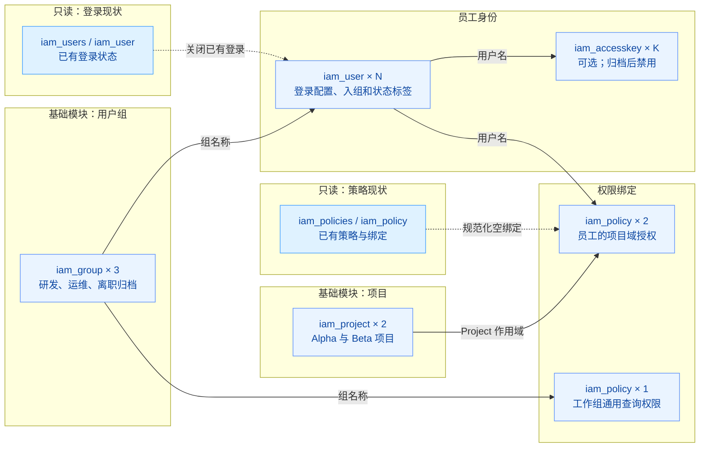

# 游戏企业人员入离调转自动化管理

基于 `volcenginecc` 的单账号 IAM 人员生命周期模板。通过 `terraform.tfvars` 的 `iam_users` 列表完成入职、转岗、离职归档和最终删除，适用于按游戏项目分配职责与权限的团队。

当前交付状态：已完成隔离环境的真实生命周期验证和第二组参数验证，测试资源已清理。详细证据与验证边界见 [VALIDATION.md](VALIDATION.md)；公开发布仍需人工审核。

## 业务背景

游戏研发与运营人员变动频繁，手工维护账号、用户组及项目授权容易留下过期权限。此模板将人员期望状态集中到一个清单，保留可评审的 Plan 和执行记录。通用权限由工作组继承，业务权限直接授予员工并限定在项目作用域，离职归档时解除全部由本工程管理的工作授权。

## 方案概述



实线表示核心资源依赖，虚线表示只读现状参与期望配置的计算。两个只读节点各聚合了列表与单对象数据源；单对象读取只针对本工程已存在的目标，首次创建时可为空。N 为人员清单数量，K 为启用访问密钥的人数。项目和用户组数量可以通过变量调整；图中的 2 个项目、3 个组及 3 个策略对应默认配置。

Provider 为 `volcengine/volcenginecc`，固定版本 `0.0.69`。IAM 对象属于账号级资源，`region` 用于 API 调用。本 POC 使用私有本地 State；生产部署应配置已核实支持的远程 Backend、加密、访问控制和按环境隔离。

## IaC 设计

| 资源 | 默认数量 | 用途与管理边界 |
| --- | --- | --- |
| volcenginecc_iam_project | 2 | 本工程独占的游戏项目 |
| volcenginecc_iam_group | 3 | 研发、运维、无权限归档组；人员成员由 user.groups 管理 |
| volcenginecc_iam_user | N | 人员身份、登录配置、用户组与标签 |
| volcenginecc_iam_accesskey | K | 员工可选访问密钥；归档禁用、关闭开关或移除员工时删除 |
| volcenginecc_iam_policy | 项目数 + 1 | 通用组授权和员工 Project 作用域授权，统一管理权限绑定 |

另有 `iam_policies`、`iam_policy`、`iam_users`、`iam_user` 数据源用于读取现状，不创建或纳管额外云资源。

根模块编排三个子模块：`foundation` 建立项目和组，`identities` 管理人员与密钥，`authorization` 管理策略及绑定。Provider 配置只在根模块。`iam_user.policies`、`iam_group.users` 和 `iam_group.attached_policies` 保留为计算属性，避免与其他管理方争抢同一关联。

## 幂等与登录状态处理

Provider 0.0.69 会把空策略绑定回读为 `null`。本模板先读取目标策略：仍有旧绑定时显式提交空列表执行撤权，已经为空时使用 `null`，避免永久差异。全局作用域采用服务端实际返回的 `project_name = ""` 形式。没有使用 ignore_changes 隐藏权限变更。

关闭登录时同样区分现状：没有登录配置则保持不创建；已有开启的登录配置则显式关闭。资源后置条件检查实际登录状态，防止把“未配置”误当成“已禁用”。

只读列表数据源取得标识后，只查询本工程目标对象的详情。已核实当前 Provider 会完整处理分页；因此运行 Plan 也需要相应 List/Get 权限。权限读取失败会中止 Plan。

## 前置条件

1. Terraform 1.9+；可以连接 Terraform Registry 和火山引擎 API。
2. 明确测试账号和独占前缀，确认不存在同名 IAM 对象。此模板不接管已有员工、已有项目或已有 State。
3. 执行身份需要 Cloud Control 权限，以及目标 IAM 资源创建、读取、变更、绑定、回收、登录配置、标签和密钥相关权限。具体底层动作以 `DescribeResourceType` 返回的各 handler.permissions 为准；仅有 CloudControlFullAccess 不代表具有底层 IAM 权限。
4. 启用登录时，初始密码必须满足该账号的密码策略；首次登录强制重置。需要 MFA 的生产环境应在身份交付流程中绑定 MFA 并启用登录保护。
5. 非本工程创建的访问密钥、角色、身份或外部授权不在 Terraform State 内，离职前需按下文进行外部关联盘点。

执行凭证从 Provider 支持的运行环境读取，例如 `VOLCENGINE_ACCESS_KEY`、`VOLCENGINE_SECRET_KEY` 和可选的 `VOLCENGINE_SESSION_TOKEN`。不要写入 `.tf`、tfvars 或脚本。核对真实 STS 身份；工具的既有登录配置可能与环境凭证不同。

## 参数与输出

| 变量 | 默认值/入口 | 说明 |
| --- | --- | --- |
| region | cn-beijing | API 调用地域 |
| name_prefix | game-iam | 独占名称前缀，转岗时保持不变 |
| environment | poc | 员工环境标签 |
| projects | alpha、beta | 逻辑项目及显示信息 |
| groups | developers、operations、offboarded | 逻辑职责组及归档组 |
| common_policy_groups | developers、operations | 继承通用权限，禁止包含归档组 |
| common_policy_actions | ecs:DescribeRegions | 通用全局查询权限 |
| project_policy_actions | vpc:DescribeVpcs | Project 作用域内操作，按实际岗位最小化配置 |
| iam_users | [] | 唯一人员清单入口；默认不创建员工 |
| initial_passwords | null，敏感 | 按逻辑员工名映射初始密码，仅从安全运行环境注入 |

输出 `user_names`、`group_names`、`project_names`、`policy_names` 用于核对。可选的 `access_credentials` 为 sensitive 输出，供安全分发使用。`terraform output -json` 会输出敏感值，不能直接写入报告或共享日志。

## 使用说明

先复制 `terraform.tfvars.example` 为 `terraform.tfvars`，选择独占前缀和目标人员配置。

```bash
terraform init
terraform fmt -check -recursive
terraform validate
terraform plan
```

确认账号、资源范围及 Plan 后执行 `terraform apply`。默认示例启用 1 名员工、关闭控制台登录和密钥，共创建 9 个资源；开启该员工的访问密钥后为 10 个。实际数量以当前参数的 Plan 为准。

**入职**：在 `iam_users` 加入条目，指定逻辑 groups/projects。若启用登录，将 `enable_login` 设为 true，并通过安全运行环境注入 `TF_VAR_initial_passwords` JSON 映射；密码不放在人员清单。若启用编程访问，设置 `enable_access_key=true`，通过安全渠道交付生成的密钥。

**转岗**：按 `examples/transfer.tfvars.example` 修改同一员工的 groups/projects，保持 user_name 和 name_prefix 不变。Plan 应调整组和项目绑定而保留员工身份。变更后检查旧策略/旧项目授权已解除，新授权生效。

**离职归档**：设置 `is_offboarding=true`。员工进入无权限归档组，项目策略解除，登录禁用，已管理密钥状态变为 inactive。原先开启的登录和密钥开关应保持 true，以执行禁用操作；若将密钥开关设为 false，则改为删除该密钥。

**最终删除**：从 `iam_users` 移除对应条目，按 `examples/remove.tfvars.example` 操作。审核 Plan 中的用户与密钥删除；Terraform 同时移除本工程管理的项目授权。归档与删除是两种明确操作，不通过改名替代。

## 验证方法

- 入职：核对实际用户名、组成员、直接策略及 Project 作用域；检查 LoginAllowed、PasswordResetRequired 和密钥状态。
- 转岗：分别核对原/新组和原/新项目授权；使用测试员工身份验证目标项目允许、非目标项目拒绝。只读列表为空不等于权限拒绝，应结合服务端明确拒绝或 DryRun 授权结果判断。
- 离职：检查归档组无策略、工作组已退出、直接项目策略已解除、登录禁用、密钥失效。盘点 IAM 原生 API 返回的全部密钥和绑定，确保没有 Terraform 外创建的残留；发现外部关联时先列出，再按授权回收，不静默扩大删除范围。
- 幂等：每个 Apply 后重新 Plan，预期 No changes；如回读差异需记录并修复，不能通过大范围 ignore_changes 掩盖。
- 可复用性：使用另一独占前缀或第二组关键参数执行 Plan，核对资源不引用测试账号固定 ID。
- 销毁：审核 `terraform plan -destroy`，确认仅本工程资源，取得清理授权后 `terraform destroy`；再以只读 API 核对用户、密钥、组、策略和项目均无残留。

## 失败恢复

Cloud Control 的复合创建可能先创建用户，再在登录配置失败时返回错误。重试前用只读 API 核对独占前缀、创建时间和实体身份；确认属于本轮创建但未进入 State 的对象后，导入原资源地址，再重新执行完整 Plan/Apply。不要直接重复创建，也不要把陌生的同名对象直接纳管。

本次实测覆盖了该恢复路径。密码必须满足目标账号实际策略；验证使用运行时生成的强随机密码，没有将密码写入参数文件或文档。

## 密钥、State 与限制

初始密码和自动生成的访问密钥可能由 Terraform 保存在 State/Plan 中；`sensitive` 只隐藏常规展示，不提供加密。验证目录需要严格文件权限，生产采用加密远程状态；原始 State、Plan、真实 tfvars 和凭证不进入版本控制或交付 ZIP。

Provider 0.0.69 的访问密钥 secret_access_key 是计算属性，Schema 未标记敏感。模板将凭证输出显式标记 sensitive；保存或共享任何日志前仍需脱敏检查。State 权限与密钥安全分发是必要的运行前置条件。

Terraform 的多资源变更由多个 API 请求完成；权限切换需要在完成 Apply 后核对旧授权撤销与新授权生效。

本工程自动管理自己创建的身份和关联。HR 事件接入、SSO、企业组织、多账号治理、外部账号纳管和监控告警属于独立集成，不作为本模板已经部署的能力。公开发布前需完成 VALIDATION.md 中的生命周期证据并经人工审核。

## 方案价值

使用稳定人员键、明确关联管理方和项目作用域，能将每次人事变更转为可审查的资源差异；后续可把经过审批的 HR 变更映射为 `iam_users` 更新，并保留人工确认和执行证据。
