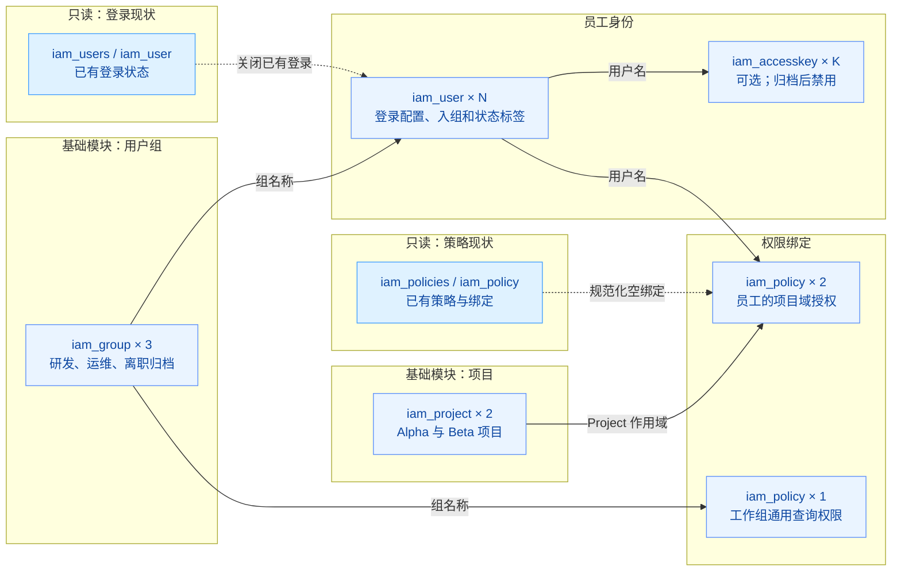

# 企业人员入离调转自动化管理

在火山引擎上以单账号 IAM（Identity and Access Management）的方式管理企业员工的身份生命周期，统一完成员工入职、转岗、离职归档和最终删除，并按项目分配职责与权限。

## 1. 业务背景

企业人员（入职、离职、转岗）流动频繁，在单账号 IAM 管理模式下，每一次人员变动都需要在火山引擎控制台进行一系列手动操作，效率低且容易埋下安全隐患：

- **操作繁琐，效率低下**：新员工入职需手动创建子用户、设置登录密码、绑定初始策略、加入用户组并关联项目；转岗要更新用户组和项目权限；离职要及时完整地剥离全部权限。整个流程跨多个控制台页面，耗时耗力。
- **权限配置易出错**：手动配置容易因疏忽导致权限过大或过小，例如漏关联关键项目，或离职员工权限未完全回收，影响业务运行与数据安全。
- **审计与合规困难**：手动操作缺乏标准化记录，难以追溯每次权限变更的原因与细节，给安全审计和合规审查带来障碍。
- **密钥管理不便**：编程访问所需的访问密钥，其创建、轮转和禁用需要精细化管理，手动操作难以保障密钥生命周期安全。

本方案将人员期望状态集中到一个清单，通过 Terraform 把每次人事变更转为可评审的资源差异，实现 IAM 身份生命周期的自动化、标准化与安全闭环。

## 2. 方案概述

方案以一份 `iam_users` 人员清单作为唯一入口，完成 IAM 子用户的创建、权限变更与回收：

- **关键事件**：入职（新增条目，分配用户组与项目）、转岗（修改条目的 groups/projects）、离职（`is_offboarding=true`，归档到无权限组）、删除（移除条目）。
- **权限模型**：通用权限通过用户组继承（跨项目的只读权限附加到组）；业务权限通过 Project 作用域直接授予员工，严格限定在其负责的项目内。
- **安全配置**：新用户首次登录强制重置密码；离职时保留用户身份供审计，同时移出授权组、清空直接策略、禁用登录并将访问密钥置为 inactive；所有资源附标准化标签便于追溯。
- **密钥管理**：为需要编程访问的研发人员可选启用 AK/SK，归档时自动禁用。



实线表示核心资源依赖，虚线表示只读现状参与期望配置的计算。两个只读节点各聚合了列表与单对象数据源，单对象读取只针对本工程已存在的目标，首次创建时可为空。N 为人员清单数量，K 为启用访问密钥的人数；图中的 2 个项目、3 个组和 3 个策略对应默认配置。


## 3. IaC 设计

### 3.1 资源清单

本工程默认参数（2 个项目、3 个用户组、1 名员工）下创建的资源如下：

| Terraform 资源 | 用途 |
| --- | --- |
| `volcenginecc_iam_project` ×2 | 本工程独占的项目，作为 Project 作用域授权的容器 |
| `volcenginecc_iam_group` ×3 | 研发、运维、无权限归档组；成员由 `user.groups` 管理 |
| `volcenginecc_iam_user` ×N | 员工身份、登录配置、用户组关联与状态标签 |
| `volcenginecc_iam_accesskey` ×K | 员工可选访问密钥；归档禁用，关闭开关或移除员工时删除 |
| `volcenginecc_iam_policy` ×(项目数+1) | 1 个工作组通用授权 + 每个项目 1 个员工 Project 作用域授权 |

另有 `iam_policies`、`iam_policy`、`iam_users`、`iam_user` 数据源用于读取现状（规范化空绑定、关闭已有登录），不创建或纳管额外云资源。

### 3.2 工程结构

工程采用模块化设计，根模块负责编排，各子模块封装具体资源：

```text
.
├── main.tf                      # 根模块编排，按依赖关系调用三个子模块
├── variables.tf                 # 全局变量定义（前缀、项目、组、人员清单等）
├── outputs.tf                   # 输出用户名、组名、项目名、策略名及可选凭证
├── providers.tf                 # volcenginecc Provider 配置
├── versions.tf                  # Terraform 与 Provider 版本约束
├── checks.tf                    # 跨变量校验（check 块，兼容 Terraform 1.5.7）
├── terraform.tfvars             # 默认变量文件（入职场景）
├── examples/                    # 场景化 tfvars 示例
│   ├── transfer.tfvars.example  # 转岗
│   ├── offboard.tfvars.example  # 离职归档
│   └── remove.tfvars.example    # 最终删除
└── modules/
    ├── foundation/              # 项目与用户组
    ├── identities/              # 员工身份、登录配置与访问密钥
    └── authorization/           # 通用策略与项目域授权绑定
```

根模块编排三个子模块：`foundation` 建立项目和组，`identities` 管理人员与密钥，`authorization` 管理策略及绑定。Provider 配置只在根模块。`iam_user.policies`、`iam_group.users` 和 `iam_group.attached_policies` 保留为计算属性，避免与其他管理方争抢同一关联。

### 3.3 核心代码示例

根模块以 `iam_users` 清单为唯一入口，按依赖顺序编排三个子模块，通过输出传递实际名称：

```hcl
module "foundation" {
  source      = "./modules/foundation"
  name_prefix = var.name_prefix
  projects    = var.projects
  groups      = var.groups
}

module "identities" {
  source            = "./modules/identities"
  name_prefix       = var.name_prefix
  iam_users         = var.iam_users
  group_names       = module.foundation.group_names
  offboarding_group = var.offboarding_group
  initial_passwords = var.initial_passwords
  environment       = var.environment
}

module "authorization" {
  source                 = "./modules/authorization"
  name_prefix            = var.name_prefix
  iam_users              = var.iam_users
  user_names             = module.identities.user_names
  group_names            = module.foundation.group_names
  project_names          = module.foundation.project_names
  common_policy_groups   = var.common_policy_groups
  common_policy_actions  = var.common_policy_actions
  project_policy_actions = var.project_policy_actions
}
```

`identities` 模块以员工 `user_name` 为稳定 `for_each` 键，转岗只改关联、离职保留身份，并按状态决定登录配置与密钥启停：

```hcl
resource "volcenginecc_iam_user" "this" {
  for_each     = local.users
  user_name    = "${var.name_prefix}-${each.key}"
  display_name = each.value.display_name
  # 归档进入无权限组，否则映射到员工声明的工作组
  groups = each.value.is_offboarding ? [var.group_names[var.offboarding_group]] : [
    for group in each.value.groups : var.group_names[group]
  ]
  # 启用登录时强制首次改密；关闭登录按现状决定是否显式禁用
  login_profile = each.value.enable_login ? {
    login_allowed           = !each.value.is_offboarding
    password                = try(var.initial_passwords[each.key], null)
    password_reset_required = true
    safe_auth_flag          = false
  } : (/* 省略：按现状关闭已开启的登录 */ null)
  tags = [
    { key = "Project", value = var.name_prefix },
    { key = "Environment", value = var.environment },
    { key = "Lifecycle", value = each.value.is_offboarding ? "offboarded" : "active" }
  ]
}
```

## 4. 使用说明

本工程支持通过 InfraManager 在云上一键部署或下载模板在本地运行。推荐使用云上部署方式，无需自行准备 Terraform 运行环境，只需在平台填写参数即可完成资源创建和托管。

### 4.1 云上部署

InfraManager 是火山引擎提供的 Terraform 托管工作台，更多产品介绍参见 [InfraManager 产品介绍](https://docs.volcengine.com/docs/infrastructure-management/product-introduction?lang=zh)。

#### 4.1.1 准备权限

为部署使用的身份授予 `CloudControlFullAccess` 和 `IAMFullAccess`，用于管理 Cloud Control 及本工程涉及的 IAM 资源。

#### 4.1.2 选择模板

打开 [InfraManager 控制台](https://console.volcengine.com/iac)，进入 **模板管理 > 公开模板**，搜索“企业人员入离调转自动化管理”。

#### 4.1.3 创建资源栈

选择模板并点击 **创建资源栈**，根据实际需求填写资源栈信息和模板参数。创建并检查执行计划，确认变更符合预期后，点击 **执行部署**。

#### 4.1.4 部署验证

在资源栈详情页查看部署状态为“成功”，再查看模板输出：

| 输出 | 用途 |
| --- | --- |
| `user_names` | 查看实际创建的员工用户名 |
| `group_names` | 查看实际创建的用户组名称 |
| `project_names` | 查看实际创建的项目名称 |
| `policy_names` | 查看通用策略和项目策略名称 |
| `access_credentials` | 查看可选访问凭证，仅限授权人员使用 |

当前示例参数应创建 2 个项目、3 个用户组、1 个用户和 3 个策略，共 9 个云资源，在详情页的资源页签可查看对应信息。启用访问密钥后还会增加对应的密钥资源。实际数量以填写的参数为准。

### 4.2 本地部署
您也可以下载本工程模板在本地运行，需要按照下述步骤操作。

#### 4.2.1 环境准备

本工程执行前需要完成以下准备：

1. 安装 Terraform，版本需满足 `versions.tf` 中的约束；确保运行环境可访问 Terraform Registry 和火山引擎 OpenAPI。
2. 在火山引擎控制台确认目标账号与独占前缀，确保不存在同名 IAM 对象。本工程不接管已有员工、已有项目或已有 State。
3. 为执行身份准备权限：Cloud Control 相关权限，以及目标 IAM 资源的创建、读取、变更、绑定、回收、登录配置、标签和密钥权限。运行 Plan 时也需要 List/Get 权限用于读取现状；权限读取失败会中止 Plan。
4. 启用登录时，初始密码必须满足账号密码策略，首次登录强制重置；需要 MFA 的生产环境应在身份交付流程中绑定 MFA。

推荐使用环境变量注入访问凭证：

```bash
export VOLCENGINE_ACCESS_KEY="your_access_key"
export VOLCENGINE_SECRET_KEY="your_secret_key"
export VOLCENGINE_REGION="cn-beijing"
```

启用控制台登录时，初始密码通过安全运行环境以敏感变量注入，键对应员工 `user_name`：

```bash
export TF_VAR_initial_passwords='{"employee01":"<strong-password>"}'
```

按需修改仓库中的 `terraform.tfvars`，确保 `name_prefix` 使用目标账号内独占前缀。

重点确认以下参数：

| 参数 | 默认值/入口 | 说明 |
| --- | --- | --- |
| `region` | `cn-beijing` | API 调用地域 |
| `name_prefix` | `game-iam` | 独占名称前缀，转岗时保持不变 |
| `environment` | `poc` | 员工环境标签 |
| `projects` | `alpha`、`beta` | 逻辑项目及显示信息 |
| `groups` | `developers`、`operations`、`offboarded` | 逻辑职责组及归档组 |
| `common_policy_groups` | `developers`、`operations` | 继承通用权限，禁止包含归档组 |
| `common_policy_actions` | `ecs:DescribeRegions` | 通用全局查询权限 |
| `project_policy_actions` | `vpc:DescribeVpcs` | Project 作用域内操作，按岗位最小化配置 |
| `iam_users` | `[]` | 唯一人员清单入口；默认不创建员工 |
| `initial_passwords` | `null`，敏感 | 按员工名映射初始密码，仅从安全运行环境注入 |

#### 4.2.2 场景化部署示例

初始化与校验：

```bash
terraform init
terraform fmt -check -recursive
terraform validate
terraform plan
```

**入职**：在 `terraform.tfvars` 的 `iam_users` 中加入条目，指定逻辑 groups/projects。启用登录时将 `enable_login` 设为 `true` 并注入 `TF_VAR_initial_passwords`；启用编程访问时设 `enable_access_key=true`，密钥通过安全渠道交付。

```bash
terraform plan
terraform apply
```

**转岗**：按 `examples/transfer.tfvars.example` 修改同一员工的 groups/projects，保持 `user_name` 和 `name_prefix` 不变。Plan 应只调整组和项目绑定而保留员工身份。

```bash
terraform plan -var-file=examples/transfer.tfvars.example -out=transfer.tfplan
terraform apply transfer.tfplan
```

**离职归档**：按 `examples/offboard.tfvars.example` 设置 `is_offboarding=true`。员工进入无权限归档组，项目策略解除，登录禁用，已管理密钥置为 inactive。原先开启的登录/密钥开关应保持 `true` 以执行禁用操作。

```bash
terraform plan -var-file=examples/offboard.tfvars.example -out=offboard.tfplan
terraform apply offboard.tfplan
```

**最终删除**：按 `examples/remove.tfvars.example` 从 `iam_users` 移除对应条目。审核 Plan 中的用户与密钥删除后再 Apply；Terraform 同时移除本工程管理的项目授权。归档与删除是两种明确操作，不通过改名替代。

```bash
terraform plan -var-file=examples/remove.tfvars.example -out=remove.tfplan
terraform apply remove.tfplan
```

#### 4.2.3 部署预期结果

默认示例启用 1 名员工、关闭控制台登录和密钥，共创建 9 个资源（2 项目、3 组、1 用户、3 策略）；开启该员工的访问密钥后为 10 个。实际数量以当前参数的 Plan 为准。

通过以下命令查看输出：

```bash
terraform output
```

常用输出包括：

| 输出 | 说明 |
| --- | --- |
| `user_names` | 逻辑员工名到实际 IAM 用户名的映射 |
| `group_names` | 用户组逻辑键到实际名称的映射 |
| `project_names` | 项目逻辑键到实际项目名的映射 |
| `policy_names` | 通用策略及各项目策略的实际名称 |
| `access_credentials` | 可选编程访问凭证，`sensitive` 输出，供安全分发 |

`terraform output -json` 会输出敏感值，不能直接写入报告或共享日志。

#### 4.2.4 部署后简易验证

以下检查用于快速确认本次变更是否符合人员生命周期预期；完整断言和历史执行证据见文末验收记录。

1. **资源与名称**

   在 Terraform 运行目录执行 `terraform output user_names`、`group_names`、`project_names` 和 `policy_names`。预期逻辑键都能映射到带本次前缀的实际名称，且不出现计划外人员。

2. **权限关联**

   在 IAM 控制台或只读 API 中定位目标用户。入职应进入声明的工作组并获得对应 Project 作用域策略；转岗应保留同一用户身份，只切换组和项目授权。

3. **离职与密钥**

   对 `is_offboarding=true` 的用户，预期只在无权限归档组中、项目策略已解除、登录已禁用、Terraform 管理的访问密钥为 inactive。密钥停用可能存在短暂传播延迟，应在限定时间内复查，不把一次旧会话成功直接判为撤权失败。

4. **幂等性与人工登录**

   使用同一变量重新执行 `terraform plan -detailed-exitcode`，预期退出码为 0。若启用了控制台登录，再由账号使用者完成人工登录和首次改密；该页面交互不由 Terraform 自动验证。

#### 4.2.5 销毁资源

```bash
terraform plan -destroy   # 审核仅本工程资源
terraform destroy
```

注意事项：

- 销毁前确认已取得清理授权，Plan 中仅包含本工程创建的资源。
- 销毁会删除 Terraform 管理的全部资源，在生产环境请确认无误后执行。

## 5. 总结

本方案的主要优势：

- **自动化与效率**：以一份 `iam_users` 清单驱动全流程，告别跨控制台手动操作，将人事变更无缝对接到云上权限配置。
- **安全与合规**：采用"组继承 + 项目域授权"模式遵循最小权限原则，离职自动禁用并归档，保留操作历史形成完整闭环。
- **可审查**：使用稳定人员键、明确关联管理方和项目作用域，每次变更都转为可评审的资源差异。
- **标准化与可复制**：提供开箱即用的 IaC 模板与场景化示例，跨团队、跨项目权限管理保持一致，新业务可快速复用。

未来可进一步与企业 HR 系统、CMDB、堡垒机等集成，将审批后的 HR 变更映射为 `iam_users` 更新并保留人工确认与执行证据；也可接入远端 Backend、SSO 与多账号治理，构建更统一立体的云上身份治理体系。
