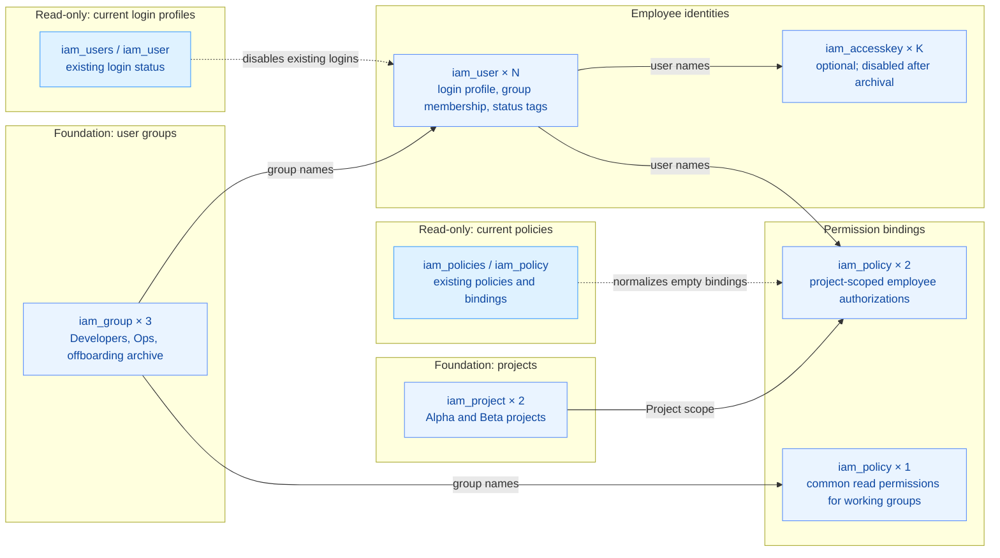

# Automated Lifecycle Management for Employee Onboarding, Transfer, and Offboarding

Manage the identity lifecycle of enterprise employees on Volcengine in a single-account IAM (Identity and Access Management) model, handling onboarding, role transfer, offboarding archival, and final deletion in a unified way, while assigning duties and permissions by project.

## 1. Business Background

Enterprise personnel (onboarding, offboarding, role transfer) move frequently. Under the single-account IAM management model, every personnel change requires a series of manual operations in the Volcengine console, which is inefficient and easily introduces security risks:

- **Cumbersome operations, low efficiency**: Onboarding a new employee manually means creating a sub-user, setting a login password, attaching an initial policy, joining user groups, and associating projects; a transfer requires updating group and project permissions; offboarding requires promptly and fully stripping all permissions. The whole process spans multiple console pages and is time-consuming.
- **Permission configuration is error-prone**: Manual configuration can easily result in permissions that are too broad or too narrow due to oversight—for example, missing a critical project association, or failing to fully revoke an offboarded employee's permissions—affecting business operations and data security.
- **Audit and compliance are difficult**: Manual operations lack standardized records, making it hard to trace the reason and details of every permission change, which obstructs security audits and compliance reviews.
- **Key management is inconvenient**: Access keys needed for programmatic access require fine-grained management for creation, rotation, and disabling; manual operations make it hard to secure the key lifecycle.

This solution centralizes the desired personnel state into a single manifest and, through Terraform, turns every personnel change into a reviewable resource diff, achieving automation, standardization, and a closed security loop for the IAM identity lifecycle.

## 2. Solution Overview

The solution uses a single `iam_users` personnel manifest as the sole entry point to create IAM sub-users and to change and revoke their permissions:

- **Key events**: Onboarding (adding an entry, assigning groups and projects), transfer (modifying an entry's groups/projects), offboarding (`is_offboarding=true`, archived to a permission-less group), and deletion (removing the entry).
- **Permission model**: Common permissions are inherited through user groups (cross-project read-only permissions are attached to groups); business permissions are granted directly to employees at Project scope, strictly confined to the projects they own.
- **Security configuration**: New users must reset their password on first login; on offboarding the user identity is retained for audit while being removed from authorized groups, direct policies are cleared, login is disabled, and access keys are set to inactive; all resources carry standardized tags for traceability.
- **Key management**: Access keys (AK/SK) can be optionally enabled for developers who need programmatic access, and are automatically disabled on archival.



Solid lines denote core resource dependencies; dashed lines denote read-only current state that participates in computing the desired configuration. Each read-only node aggregates a list data source and a single-object data source; the single-object read targets only objects already managed by this project and may be empty on first creation. N is the number of personnel entries, K is the number of employees with access keys enabled; the 2 projects, 3 groups, and 3 policies in the diagram correspond to the default configuration.


## 3. IaC Design

### 3.1 Resource Inventory

With the project's default parameters (2 projects, 3 user groups, 1 employee), the following resources are created:

| Terraform Resource | Purpose |
| --- | --- |
| `volcenginecc_iam_project` ×2 | Projects dedicated to this implementation, serving as containers for Project-scoped authorization |
| `volcenginecc_iam_group` ×3 | Developers, Ops, and permission-less archival groups; membership managed via `user.groups` |
| `volcenginecc_iam_user` ×N | Employee identities, login profiles, group associations, and lifecycle tags |
| `volcenginecc_iam_accesskey` ×K | Optional employee access keys; disabled on archival, deleted when the switch is turned off or the employee is removed |
| `volcenginecc_iam_policy` ×(number of projects+1) | 1 common policy for working groups + 1 per-project employee Project-scoped policy |

The `iam_policies`, `iam_policy`, `iam_users`, and `iam_user` data sources are additionally used to read current state (normalizing empty bindings, disabling existing logins); they do not create or manage any extra cloud resources.

### 3.2 Project Structure

The project uses a modular design: the root module orchestrates, and each submodule encapsulates specific resources:

```text
.
├── main.tf                      # Root module orchestration; invokes the three submodules in dependency order
├── variables.tf                 # Global variable definitions (prefix, projects, groups, personnel manifest, etc.)
├── outputs.tf                   # Outputs user names, group names, project names, policy names and optional credentials
├── providers.tf                 # volcenginecc provider configuration
├── versions.tf                  # Terraform and provider version constraints
├── checks.tf                    # Cross-variable validation (check blocks, compatible with Terraform 1.5.7)
├── terraform.tfvars             # Default variable file (onboarding scenario)
├── examples/                    # Scenario-based tfvars examples
│   ├── transfer.tfvars.example  # Role transfer
│   ├── offboard.tfvars.example  # Offboarding archival
│   └── remove.tfvars.example    # Final deletion
└── modules/
    ├── foundation/              # Projects and user groups
    ├── identities/              # Employee identities, login profiles and access keys
    └── authorization/           # Common policies and project-scoped authorization bindings
```

The root module orchestrates three submodules: `foundation` creates projects and groups, `identities` manages personnel and keys, and `authorization` manages policies and bindings. The Provider configuration lives only in the root module. `iam_user.policies`, `iam_group.users`, and `iam_group.attached_policies` are kept as computed attributes to avoid conflicting with other managers over the same association.

### 3.3 Core Code Examples

The root module uses the `iam_users` manifest as the sole entry point, orchestrates the three submodules in dependency order, and passes actual names through outputs:

```hcl
module "foundation" {
  source      = "./modules/foundation"
  name_prefix = var.name_prefix
  projects    = var.projects
  groups      = var.groups
}

module "identities" {
  source            = "./modules/identities"
  name_prefix       = var.name_prefix
  iam_users         = var.iam_users
  group_names       = module.foundation.group_names
  offboarding_group = var.offboarding_group
  initial_passwords = var.initial_passwords
  environment       = var.environment
}

module "authorization" {
  source                 = "./modules/authorization"
  name_prefix            = var.name_prefix
  iam_users              = var.iam_users
  user_names             = module.identities.user_names
  group_names            = module.foundation.group_names
  project_names          = module.foundation.project_names
  common_policy_groups   = var.common_policy_groups
  common_policy_actions  = var.common_policy_actions
  project_policy_actions = var.project_policy_actions
}
```

The `identities` module uses the employee's `user_name` as a stable `for_each` key: a transfer only changes associations, offboarding retains the identity, and the login profile and key enablement are determined by state:

```hcl
resource "volcenginecc_iam_user" "this" {
  for_each     = local.users
  user_name    = "${var.name_prefix}-${each.key}"
  display_name = each.value.display_name
  # Archive into the permission-less group; otherwise map to the employee's declared working groups
  groups = each.value.is_offboarding ? [var.group_names[var.offboarding_group]] : [
    for group in each.value.groups : var.group_names[group]
  ]
  # Force a password reset on first login when login is enabled; when login is disabled, explicitly disable based on current state
  login_profile = each.value.enable_login ? {
    login_allowed           = !each.value.is_offboarding
    password                = try(var.initial_passwords[each.key], null)
    password_reset_required = true
    safe_auth_flag          = false
  } : (/* omitted: disable an already-enabled login based on current state */ null)
  tags = [
    { key = "Project", value = var.name_prefix },
    { key = "Environment", value = var.environment },
    { key = "Lifecycle", value = each.value.is_offboarding ? "offboarded" : "active" }
  ]
}
```

## 4. Usage

This project supports one-click deployment in the cloud through InfraManager, or running the template locally after downloading it. Cloud deployment is recommended: you do not need to prepare a Terraform runtime yourself; simply fill in the parameters on the platform to create and host the resources.

### 4.1 Cloud Deployment

InfraManager is a managed Terraform workbench provided by Volcengine. For more product information, see [InfraManager Product Introduction](https://docs.volcengine.com/docs/infrastructure-management/product-introduction?lang=en).

#### 4.1.1 Prepare Permissions

Grant the deploying identity `CloudControlFullAccess` and `IAMFullAccess` to manage Cloud Control and the IAM resources involved in this project.

#### 4.1.2 Select a Template

Open the [InfraManager Console](https://console.volcengine.com/iac), go to **Template Management > Public Templates**, and search for the published template name shown in the Chinese console: `企业人员入离调转自动化管理` (Automated Lifecycle Management for Employee Onboarding, Transfer, and Offboarding). Use the Chinese string as the search term.

#### 4.1.3 Create a Resource Stack

Select the template and click **Create Resource Stack**. Fill in the resource stack information and template parameters according to your actual needs. Create and review the execution plan; after confirming the changes match expectations, click **Execute Deployment**.

#### 4.1.4 Deployment Verification

On the resource stack details page, confirm the deployment status is "Succeeded", then review the template outputs:

| Output | Purpose |
| --- | --- |
| `user_names` | View the actually created employee user names |
| `group_names` | View the actually created user group names |
| `project_names` | View the actually created project names |
| `policy_names` | View the common policy and project policy names |
| `access_credentials` | View the optional access credentials; only authorized personnel may use them |

The current example parameters should create 2 projects, 3 user groups, 1 user, and 3 policies—9 cloud resources in total—visible on the Resources tab of the resource stack details page. Enabling access keys adds the corresponding key resources. The actual count depends on the parameters you fill in.

### 4.2 Local Deployment
You can also download this project template and run it locally; follow the steps below.

#### 4.2.1 Environment Preparation

Before running this project, complete the following preparations:

1. Install Terraform; the version must satisfy the constraints in `versions.tf`. Ensure the runtime can reach the Terraform Registry and the Volcengine OpenAPI.
2. Confirm the target account and an exclusive prefix in the Volcengine console, and ensure no IAM objects with the same names exist. This project does not manage pre-existing employees or projects, and it does not adopt any existing state.
3. Prepare permissions for the executing identity: Cloud Control-related permissions, and permissions to create, read, change, bind, revoke, configure login, tag, and manage keys on the target IAM resources. Running Plan also requires List/Get permissions to read current state; a permission read failure aborts Plan.
4. When login is enabled, the initial password must satisfy the account password policy and must be reset on first login. Production environments requiring MFA should bind MFA during the identity delivery flow.

We recommend injecting access credentials via environment variables:

```bash
export VOLCENGINE_ACCESS_KEY="your_access_key"
export VOLCENGINE_SECRET_KEY="your_secret_key"
export VOLCENGINE_REGION="cn-beijing"
```

When console login is enabled, the initial password is injected as a sensitive variable through a secure runtime environment, with keys corresponding to the employee `user_name`:

```bash
export TF_VAR_initial_passwords='{"employee01":"<strong-password>"}'
```

Modify `terraform.tfvars` in the repository as needed, and ensure `name_prefix` uses a prefix exclusive within the target account.

Focus on confirming the following parameters:

| Parameter | Default / Entry | Description |
| --- | --- | --- |
| `region` | `cn-beijing` | Region for API calls |
| `name_prefix` | `game-iam` | Exclusive name prefix; kept unchanged during transfers |
| `environment` | `poc` | Employee environment tag |
| `projects` | `alpha`, `beta` | Logical projects and display info |
| `groups` | `developers`, `operations`, `offboarded` | Logical duty groups and the archival group |
| `common_policy_groups` | `developers`, `operations` | Inherit common permissions; must not include the archival group |
| `common_policy_actions` | `ecs:DescribeRegions` | Common global read permissions |
| `project_policy_actions` | `vpc:DescribeVpcs` | Operations within Project scope; minimized by role |
| `iam_users` | `[]` | The single entry point for the personnel manifest; no employees created by default |
| `initial_passwords` | `null`, sensitive | Maps initial passwords by employee name; injected only from a secure runtime |

#### 4.2.2 Scenario-Based Deployment Examples

Initialize and validate:

```bash
terraform init
terraform fmt -check -recursive
terraform validate
terraform plan
```

**Onboarding**: Add an entry to `iam_users` in `terraform.tfvars`, specifying logical groups/projects. To enable login, set `enable_login` to `true` and inject `TF_VAR_initial_passwords`; to enable programmatic access, set `enable_access_key=true`, and deliver the key through a secure channel.

```bash
terraform plan
terraform apply
```

**Transfer**: Modify the same employee's groups/projects according to `examples/transfer.tfvars.example`, keeping `user_name` and `name_prefix` unchanged. Plan should only adjust group and project bindings while retaining the employee identity.

```bash
terraform plan -var-file=examples/transfer.tfvars.example -out=transfer.tfplan
terraform apply transfer.tfplan
```

**Offboarding archival**: Set `is_offboarding=true` according to `examples/offboard.tfvars.example`. The employee moves to the permission-less archival group, project policies are detached, login is disabled, and managed access keys are set to inactive. The previously enabled login/key switches should remain `true` so that the disable actions are actually executed.

```bash
terraform plan -var-file=examples/offboard.tfvars.example -out=offboard.tfplan
terraform apply offboard.tfplan
```

**Final deletion**: Remove the corresponding entry from `iam_users` according to `examples/remove.tfvars.example`. Review the user and key deletions in Plan before applying; Terraform also removes the project authorizations managed by this project. Archival and deletion are two distinct operations; do not use renaming as a substitute.

```bash
terraform plan -var-file=examples/remove.tfvars.example -out=remove.tfplan
terraform apply remove.tfplan
```

#### 4.2.3 Expected Deployment Results

The default example enables 1 employee with console login and keys disabled, creating 9 resources in total (2 projects, 3 groups, 1 user, 3 policies); enabling that employee's access key brings the total to 10. The actual count is determined by the Plan for the current parameters.

View the outputs with:

```bash
terraform output
```

Common outputs include:

| Output | Description |
| --- | --- |
| `user_names` | Mapping from logical employee names to actual IAM user names |
| `group_names` | Mapping from user group logical keys to actual names |
| `project_names` | Mapping from project logical keys to actual project names |
| `policy_names` | Actual names of the common policy and each project policy |
| `access_credentials` | Optional programmatic access credentials; a `sensitive` output for secure distribution |

`terraform output -json` prints sensitive values and must not be written directly into reports or shared logs.

#### 4.2.4 Post-Deployment Quick Verification

The following checks quickly confirm whether this change matches the personnel-lifecycle expectations.

1. **Resources and Names**

   In the Terraform runtime directory, run `terraform output user_names`, `group_names`, `project_names`, and `policy_names`. Expect every logical key to map to an actual name carrying the configured `name_prefix`, and no unexpected personnel to appear.

2. **Permission Associations**

   Locate the target user in the IAM console or via read-only APIs. Onboarding should place the user in the declared working groups and grant the corresponding Project-scoped policy; a transfer should retain the same user identity and only switch group and project authorizations.

3. **Offboarding and Keys**

   For a user with `is_offboarding=true`, expect the user to be only in the permission-less archival group, project policies detached, login disabled, and Terraform-managed access keys inactive. Key deactivation may have a brief propagation delay; re-check within a limited window, and do not treat a single successful old session as a revocation failure.

4. **Idempotency and Manual Login**

   Re-run `terraform plan -detailed-exitcode` with the same variables; expect exit code 0. If console login was enabled, have the account user complete manual login and first-password reset; that page interaction is not automatically verified by Terraform.

#### 4.2.5 Destroying Resources

```bash
terraform plan -destroy   # Review: only this project's resources
terraform destroy
```

Notes:

- Before destroying, confirm cleanup authorization has been obtained and that Plan contains only resources created by this project.
- Destroy deletes all Terraform-managed resources; in production, confirm carefully before executing.

## 5. Summary

The main advantages of this solution:

- **Automation and efficiency**: A single `iam_users` manifest drives the whole flow, eliminating cross-console manual operations and seamlessly connecting personnel changes to cloud permission configuration.
- **Security and compliance**: The "group inheritance + project-scoped authorization" model follows the least-privilege principle; offboarding automatically disables and archives, retaining the operation history to form a complete closed loop.
- **Reviewability**: Stable personnel keys, explicit association owners, and project scoping turn every change into a reviewable resource diff.
- **Standardization and reproducibility**: Out-of-the-box IaC templates and scenario examples keep permission management consistent across teams and projects, letting new businesses reuse them quickly.

Future work can further integrate with enterprise HR systems, CMDBs, and bastion hosts, mapping approved HR changes into `iam_users` updates while retaining manual confirmation and execution evidence. It can also connect to remote backends, SSO, and multi-account governance to build a more unified and comprehensive cloud identity governance system.
